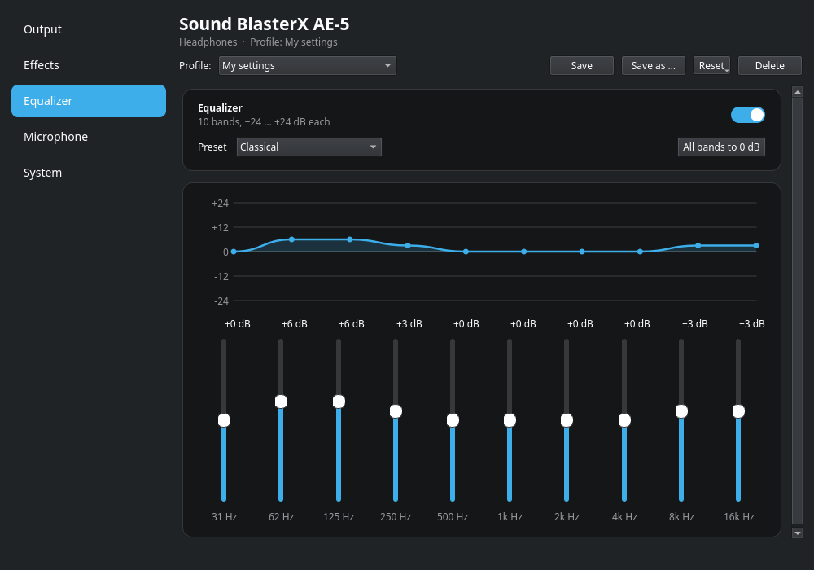
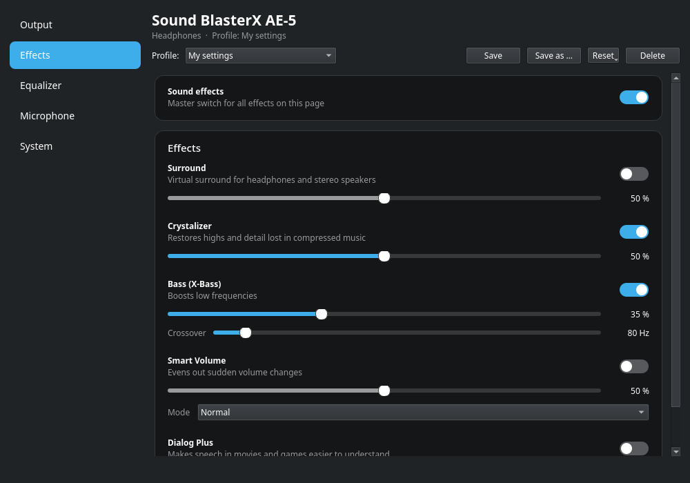
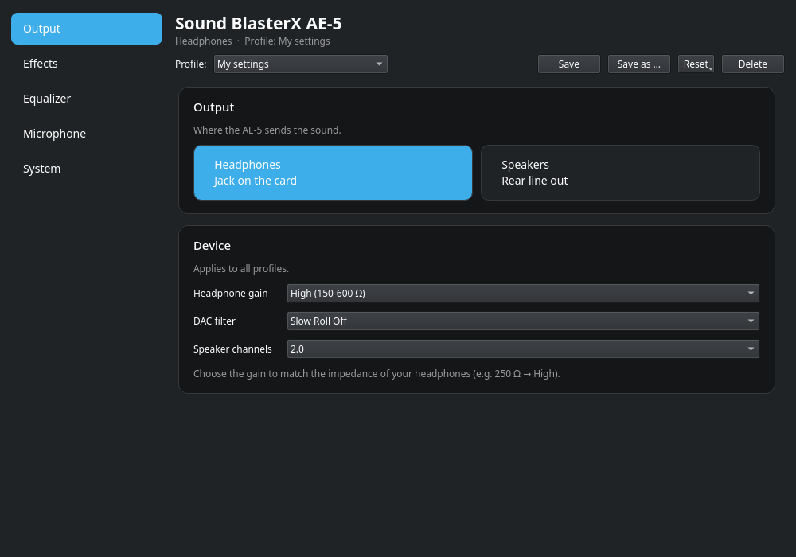

# Sound BlasterX AE-5 on Linux – stable sound + settings app

[](https://github.com/Kamegohan/soundblaster-ae5-linux/actions/workflows/tests.yml) [](LICENSE)

**[Deutsche Version → README.de.md](README.de.md)**

The Creative Sound BlasterX **AE-5 / AE-5 Plus** is a great card, but on Linux it has two problems:

1. **The sound drops out and only a reboot brings it back.** Typical trigger: you pick up your headset, the cable moves or there is a small static discharge – the card's DSP hangs. Other devices (USB mic, HDMI) keep working, the AE-5 stays silent.
2. **There is no settings app** like Creative's Windows software, although the Linux driver exposes almost every control (effects, equalizer, headphone gain, DAC filter, microphone effects).

This project fixes both – without patching the kernel:

- A **watchdog** detects the hang within ~6 seconds and restarts *only the AE-5* (no reboot, no PipeWire restart). Sound is back after ~20 seconds; running apps and games stay connected (some, like Spotify, pause – just press play).
- A **settings app** (Qt) with profiles, effects, a 10-band equalizer, microphone effects and a tray icon. German and English.
- Fixes for several silent-output traps of the AE-5 under PipeWire (see [What it fixes](#what-it-fixes)).



| Effects | Output |
|---|---|
|  |  |

## Supported hardware

- Creative Sound BlasterX **AE-5** and **AE-5 Plus** (PCI `1102:0012`, subsystem `1102:0191`, CA0132 codec, driver `snd_hda_codec_ca0132`).
- Tested on an AE-5 Plus with CachyOS (Arch), kernel 7.2/7.3, PipeWire 1.6 + WirePlumber, KDE Plasma 6 (Wayland).
- Other CA0132 cards (Sound Blaster Z, ZxR, AE-7, Recon3D) are **not** supported (yet) – they use different models in the driver. Pull requests welcome.

Check your card:

```bash
lspci -nn | grep -i 1102:0012
```

## What it fixes

| Problem | Cause | Fix |
|---|---|---|
| Sound gone after picking up the headset, only a reboot helps | Static discharge / cable movement makes the card's DMA hang (`pcm RUNNING`, `hw_ptr` stuck) | Watchdog restarts only the AE-5 (PCI remove + rescan) while PipeWire keeps running |
| After such a reset the card is silent and called "Sound Blaster Z" | The card reports a wrong PCI subsystem ID (`1102:0010`) after a hard reset | Driver override: model `ae5`, matched via the codec ID (patch firmware + modprobe option) |
| Headphones silent / shown as "unplugged" | PipeWire's stock headphone path mutes the `Front` control – but the AE-5 feeds its headphone amp from exactly that control | Own PipeWire (ACP) profile for the AE-5 only, assigned via udev |
| Silent after a pause, although the card accepts data | The DSP mutes the output when a stream restarts; PipeWire's idle suspend makes it worse | No idle suspend for the AE-5 + an amplifier guard that re-initializes the headphone amp whenever playback starts |

## Installation

### Arch Linux / CachyOS / Manjaro (package)

```bash
git clone https://github.com/Kamegohan/soundblaster-ae5-linux.git
cd soundblaster-ae5-linux/packaging
makepkg -si
systemctl --user daemon-reload
systemctl --user enable --now ae5-watchdog.service ae5-amp-guard.service
systemctl --user restart wireplumber pipewire pipewire-pulse
```

Reboot once afterwards so the driver override (model `ae5`) is active. Remove with `sudo pacman -R ae5-control`.

### Other distributions (manual)

Requirements: Python ≥ 3.10, PySide6, `alsa-utils` (`amixer`, `alsactl`), `pactl` (PulseAudio utils / pipewire-pulse), PipeWire + WirePlumber, polkit, systemd, `notify-send` (libnotify).

```bash
git clone https://github.com/Kamegohan/soundblaster-ae5-linux.git
cd soundblaster-ae5-linux
tools/install-model-fix.sh          # driver override (active after the next boot)
tools/install-pipewire-profile.sh   # AE-5 PipeWire profile + no idle suspend
tools/install-recovery.sh           # root helper, polkit rule, watchdog, amplifier guard
tools/install-app.sh                # menu entry + tray autostart (no root)
```

Each script accepts `--remove`. The manual installation runs from the cloned folder – don't move it afterwards.

## Usage

- **App:** "AE-5 Control" in the application menu, or `ae5-control` (`--tray` starts minimized to the tray).
  - **Profiles** contain effects, equalizer and microphone effects – never the volume, so switching can't suddenly get loud. Defaults: Neutral, Gaming, Music, Movie. "Reset" discards changes or restores the defaults.
  - **Output:** headphones/speakers, headphone gain (asks before raising it), DAC filter, speaker channels.
  - Every control has a tooltip explaining what it does.
- **Tray:** left click opens/closes the window, right click switches profiles or restarts the card.
- **Command line:**
  - `ae5ctl list | apply NAME | apply-active | save NAME | status`
  - `ae5-recover` restarts the card by hand (`--check` only tests it)
  - `ae5-diag start | mark | status | stop` records a diagnostic log
- **Language:** German if your system language is German, English otherwise. Force with `AE5_LANG=de` or `AE5_LANG=en`.

## Safety

The AE-5 headphone amp is powerful. The app asks before raising the headphone gain and offers to lower the volume first. When testing, take your headphones off or start quietly.

## Troubleshooting and bug reports

1. Start the diagnostic log: `ae5-diag start`
2. When the problem happens: `ae5-diag mark "what happened"`
3. Open an [issue](https://github.com/Kamegohan/soundblaster-ae5-linux/issues) and attach the log from `~/.local/state/ae5-control/diag/current.log`, plus the output of `lspci -nnk | grep -A3 -i creative` and `cat /proc/asound/cards`.

## How it works

| Part | Where (package) | Purpose |
|---|---|---|
| `tools/ae5-recover.sh` | `/usr/lib/ae5-control/tools` | Restarts the AE-5 in stages: 1 driver rebind, 2 PCI remove + rescan (both with PipeWire running), 3 codec reconfig (last resort, restarts PipeWire). Saves and restores mixer and volume. |
| `tools/ae5-watchdog.sh` | user service `ae5-watchdog` | Detects a hang (stream running, hardware position stuck) and calls `ae5-recover --auto --hang` |
| `tools/ae5-amp-guard.sh` | user service `ae5-amp-guard` | Re-initializes the headphone amp when playback starts |
| `system/ae5-reset-helper` + polkit policy | `/usr/lib/ae5-control`, polkit | Root helper with exactly three actions; allowed without password for the active local user |
| `config/` | firmware + modprobe.d | Forces driver model `ae5` |
| `pipewire/` + udev rule | alsa-card-profile, WirePlumber | AE-5 profile with working headphone port; no idle suspend |
| `ae5control/` | Python package | App (`gui.py`), CLI (`cli.py`), mixer access via `amixer` |

Settings are stored in `~/.config/ae5-control/` (`profiles/*.json`, `device.json`, `state.json`).

Run the tests with `python3 -m unittest discover -s tests -t .`

## Limitations

- RGB lighting of the AE-5 is not controlled by the Linux driver.
- Some apps pause when the card disappears briefly during a restart – press play.
- The DAC filter differences are very subtle (above ~18 kHz).

## Credits and license

- The equalizer preset values and the DSP knowledge come from the Linux kernel driver `sound/hda/codecs/ca0132.c` (Creative Technology Ltd. and contributors, GPL-2.0-or-later).
- This project is licensed under the **GNU General Public License v2.0 or later** – see [LICENSE](LICENSE).
- Not affiliated with Creative Technology. "Sound BlasterX" is a trademark of Creative Technology Ltd.
